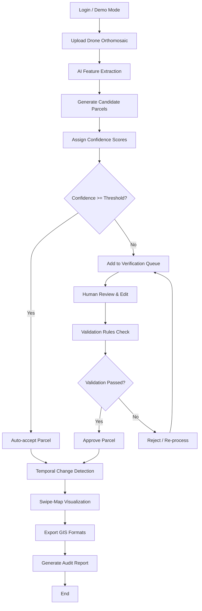

# CadastraAI End‑to‑End Workflow

**Legend**
- **Auto‑accept**: Parcels with high confidence are directly saved.
- **Verification Queue**: Low‑confidence parcels await human verification.
- **Validation Rules**: Topology, size, and attribute checks.
- **Change Detection**: Compare new parcels with historic layers.
- **Export**: GeoJSON, Shapefile, CSV, GeoTIFF.
